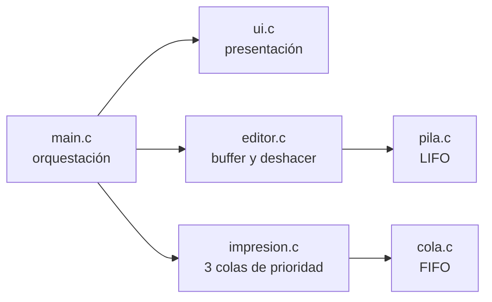
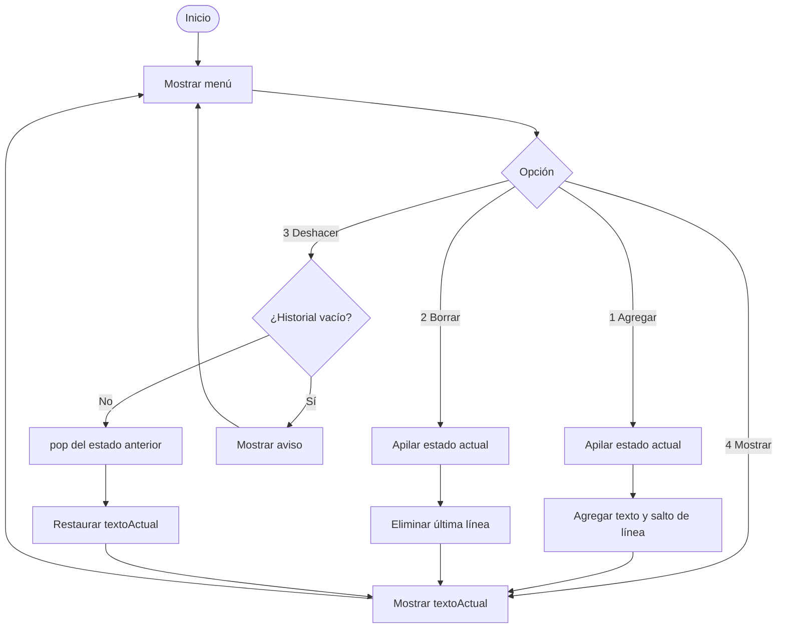
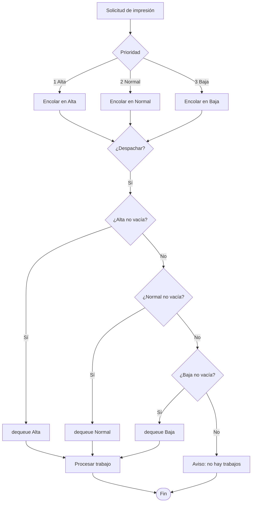

# Reporte Técnico — Editor con Deshacer y Gestor de Impresión

**Proyecto Integrador · Unidad 4: Pilas y Colas**

**Asignatura:** Estructuras de Datos y Compiladores

**Docente:** Dra. Blanca Guadalupe Estrada Rentería

**Institución:** Global University

**Programa:** Ing. en Seguridad Tecnológica y Desarrollo de Software

**Integrantes:** Karina Patricia Ibarra Morales · Aarón Salvador Castañeda Ruiz

**Fecha:** Octubre de 2026

> **Alcance de este documento:** secciones de arquitectura, diseño, teoría LIFO/FIFO y diagramas de flujo correspondientes al trabajo de Karina. No incluye las capturas de los 8 casos de prueba ni el desglose de aportes individuales de Aarón; esas secciones se integran por separado.

---

## 1. Arquitectura general

El sistema se organiza en módulos desacoplados. Cada estructura de datos expone una interfaz mínima en `include/` y su implementación vive en `src/`.



### 1.1. Responsabilidades por módulo

| Módulo | Responsabilidad | Estado |
|---|---|---|
| `src/pila.c` | Estructura LIFO: `push`, `pop`, `peek`, `pilaVacia`, `limpiarPila`. | Implementado por Karina |
| `src/editor.c` | Buffer de texto, snapshots previos a cada edición y Deshacer. | Implementado por Karina |
| `src/ui.c` | Menú, bordes Unicode, limpieza de pantalla, UTF-8 y espera de Enter. | Implementado por Karina |
| `src/cola.c` | Estructura FIFO: `enqueue`, `dequeue`, validación de cola vacía. | Pendiente (Aarón) |
| `src/impresion.c` | Colas Alta (1), Normal (2) y Baja (3), despacho no expropiativo. | Pendiente (Aarón) |
| `src/main.c` | Integración del flujo editor → impresión y menú interactivo. | Pendiente (integración) |
| `Makefile` | Compilación automatizada con GCC. | Pendiente de reparación |

### 1.2. Flujo general

1. El usuario edita el texto mediante `editor.c`.
2. Antes de cada modificación, el editor apila una copia del estado actual en `pila.c`.
3. Al enviar a imprimir, `main.c` debe entregar a `impresion.c` una **copia inmutable** del texto.
4. `impresion.c` encola el trabajo en la cola de su prioridad.
5. El despacho elige la cola no vacía de mayor prioridad y respeta FIFO dentro de cada nivel.

La separación evita que el editor y el gestor de impresión compartan estado mutable: modificar el texto después de enviarlo no altera el trabajo ya encolado.

---

## 2. Pila (LIFO) y mecanismo de Deshacer

### 2.1. Definición

Una pila es una estructura **LIFO** (*Last In, First Out*): el último elemento insertado es el primero en salir. El único punto de acceso es el **TOPE**.

Operaciones principales:

| Operación | Acción | Caso borde |
|---|---|---|
| `push(p, texto)` | Crea un nodo, copia el texto y lo enlaza en el TOPE. | Si `texto` es `NULL`, guarda cadena vacía. |
| `pop(p)` | Extrae el nodo del TOPE y devuelve una copia del texto. | Si la pila está vacía, devuelve `NULL`. |
| `peek(p)` | Consulta el texto del TOPE sin extraerlo. | Si la pila está vacía, devuelve `NULL`. |
| `pilaVacia(p)` | Indica si el TOPE es `NULL`. | Si el puntero a la pila es `NULL`, también se considera vacía. |
| `limpiarPila(p)` | Libera todos los nodos y reinicia `tamanio`. | Es segura si se llama más de una vez. |

### 2.2. Representación en memoria

```c
typedef struct NodoPila {
    char texto[MAX_TEXTO];
    struct NodoPila *siguiente;
} NodoPila;

typedef struct {
    NodoPila *tope;
    size_t tamanio;
} Pila;
```

- Cada nodo almacena una **instantánea completa** del texto (`MAX_TEXTO = 4096`).
- `tope` apunta al nodo más reciente.
- `siguiente` enlaza hacia el estado anterior.
- `tamanio` permite consultar cuántos estados hay en el historial sin recorrer la pila.

Complejidad:

- `push`, `pop` y `peek`: **O(1)** sobre la estructura, más **O(n)** por la copia del texto.
- Memoria: **O(k · MAX_TEXTO)**, donde `k` es el número de estados guardados.
- `pop` devuelve una **copia en heap**; el llamador debe liberarla con `free()`. `peek` devuelve un puntero interno y **no** debe liberarse.

### 2.3. Snapshots y regla de Deshacer

El editor no guarda comandos ni diferencias: guarda el **estado completo anterior** antes de modificar el buffer.

Secuencia de una edición:

1. Se verifica que el texto nuevo no esté vacío y que haya espacio en el buffer.
2. Se apila `textoActual` en el historial.
3. Si el `push` falla por falta de memoria, la edición se cancela para no perder la posibilidad de deshacer.
4. Se modifica `textoActual` (agregar línea o borrar la última).
5. El nuevo estado queda visible, pero **no** se apila: el historial solo contiene estados anteriores.

Secuencia de Deshacer:

1. Si `pilaVacia(&historial)`, se muestra `No hay cambios para deshacer.` y no se modifica nada.
2. Si hay historial, `pop` extrae el estado anterior.
3. Se copia ese estado en `textoActual`.
4. Se libera la copia devuelta por `pop`.
5. **No** se apila el estado actual; así, deshacer repetidamente recorre el historial hacia atrás sin crear un ciclo.

### 2.4. Ejemplo de traza

| Paso | Acción | `textoActual` | Historial (TOPE → fondo) |
|---|---|---|---|
| 0 | Inicio | `""` | vacío |
| 1 | Agregar `Hola` | `Hola\n` | `""` |
| 2 | Agregar `Mundo` | `Hola\nMundo\n` | `Hola\n` → `""` |
| 3 | Deshacer | `Hola\n` | `""` |
| 4 | Deshacer | `""` | vacío |
| 5 | Deshacer | `""` | vacío + aviso |

### 2.5. Decisiones de diseño

- **Snapshots completos:** simplifican la implementación y garantizan que cualquier estado pueda recuperarse sin reconstruir operaciones.
- **Costo de memoria acotado:** el proyecto maneja sesiones cortas; el número de estados es pequeño. Si el historial creciera demasiado, se podría limitar a `k` estados o guardar diferencias.
- **`pop` con copia:** evita devolver un puntero a memoria liberada. El costo es una reserva adicional por cada Deshacer.
- **Deshacer no apila:** cumple la regla LIFO y evita que el historial crezca al consultar estados anteriores.
- **`agregarTexto` agrega `\n`:** el editor trabaja por líneas; así `borrarUltimaLinea` puede delimitar con claridad la última línea. Si el texto ya termina en salto de línea, no se duplica.
- **Buffer acotado:** toda copia respeta `MAX_TEXTO - 1` y termina en `'\0'`; los textos más largos se truncan.

---

## 3. Cola FIFO y prioridades (diseño)

### 3.1. Definición FIFO

Una cola es una estructura **FIFO** (*First In, First Out*): el primer elemento insertado es el primero en salir. Se mantienen dos referencias:

- `frente`: primer elemento a atender.
- `final`: último elemento insertado.

`enqueue` inserta al final y `dequeue` extrae del frente. Ambas operaciones son **O(1)**.

### 3.2. Tres colas independientes

El gestor de impresión mantiene tres colas separadas:

| Nivel | Prioridad | Uso |
|---|---|---|
| Alta | 1 | Trabajos urgentes. |
| Normal | 2 | Trabajos ordinarios. |
| Baja | 3 | Trabajos diferibles. |

Regla de despacho:

1. Si la cola Alta no está vacía, se atiende su frente.
2. Si Alta está vacía y Normal no, se atiende el frente de Normal.
3. Si Alta y Normal están vacías y Baja no, se atiende el frente de Baja.
4. Si las tres están vacías, se informa que no hay trabajos pendientes.

Dentro de cada nivel se respeta estrictamente FIFO.

### 3.3. Regla no expropiativa

Un trabajo en proceso **no se interrumpe**. Si llega un trabajo de prioridad Alta mientras otro se está procesando, el nuevo trabajo espera a que termine el actual; se atenderá en el siguiente despacho, respetando FIFO dentro de la cola Alta. Esto mantiene la coherencia del recurso de impresión y evita reinicios.

Trade-off: la prioridad estricta puede postergar indefinidamente trabajos de prioridad Baja si llegan muchos trabajos de prioridad Alta. Una mejora futura sería aplicar envejecimiento (*aging*) a los trabajos de baja prioridad.

### 3.4. Por qué tres colas y no una lista ordenada

- **Inserción O(1):** encolar solo actualiza `final` de la cola correspondiente.
- **Despacho predecible:** la prioridad se resuelve eligiendo la cola, y el orden dentro de cada nivel queda garantizado por FIFO.
- **Menos errores:** no se recalcula un ordenamiento en cada llegada.
- **Costo:** el número de prioridades es fijo; si se requirieran muchos niveles, otra estructura sería más adecuada.

### 3.5. Copia inmutable al imprimir

Al enviar un documento, el texto debe copiarse al campo `texto` del `Trabajo`. El editor puede seguir modificando `textoActual`; el trabajo encolado conserva la versión enviada. Esta decisión cubre el caso de prueba 8 de la rúbrica.

---

## 4. Diagramas de flujo

### 4.1. Flujo del editor



### 4.2. Flujo de impresión



---

## 5. Contratos de integración para `main.c`

Estos puntos deben respetarse al conectar la interfaz con el editor y el gestor de impresión.

### 5.1. Interfaz (`ui.c`)

- `limpiarPantalla()` configura UTF-8 en Windows y limpia la terminal. Debe llamarse al inicio y antes de redibujar el menú.
- `mostrarMenu()` imprime el menú de 8 opciones y el texto `Seleccione una opcion: `. **No lee** la opción.
- `mostrarLineaSeparadora()` imprime una línea Unicode de 60 columnas.
- `esperarEnter()` espera a que el usuario presione Enter. En Windows usa `_getch`, por lo que no consume el salto de línea pendiente de `stdin`.

### 5.2. Flujo esperado en `main.c`

1. Inicializar `Editor` y `GestorImpresion`.
2. Llamar `limpiarPantalla()`.
3. Repetir:
   - `mostrarMenu()`.
   - Leer la opción y validar que esté entre 1 y 8.
   - Ejecutar la acción.
   - `esperarEnter()`.
4. Salir con la opción 8.

Opciones acordadas:

| Opción | Acción |
|---|---|
| 1 | Leer una línea y llamar `agregarTexto`. |
| 2 | Llamar `borrarUltimaLinea`. |
| 3 | Llamar `deshacer`. |
| 4 | Llamar `mostrarTexto`. |
| 5 | Leer prioridad y páginas, validar y enviar una copia a impresión. |
| 6 | Despachar el siguiente trabajo. |
| 7 | Mostrar el estado de las tres colas. |
| 8 | Salir. |

Recomendaciones de lectura:

- Después de `scanf("%d", ...)`, consumir el salto de línea pendiente antes de `fgets`, o leer también la opción con `fgets`.
- Validar que las páginas sean mayores que cero y que la prioridad sea 1, 2 o 3.
- Enviar a impresión una copia del texto, no un puntero a `textoActual`.

### 5.3. Editor (`editor.c`)

- `agregarTexto` ignora textos vacíos o `NULL`, apila el estado anterior y agrega `\n` si hace falta.
- `borrarUltimaLinea` apila el estado anterior y elimina la última línea; si no hay texto, muestra un aviso y no modifica el historial.
- `deshacer` restaura el estado anterior y no lo vuelve a apilar.
- El buffer está limitado por `MAX_TEXTO`; los textos largos se truncan de forma segura.

### 5.4. Pila (`pila.c`)

- `pop` devuelve una copia en heap; el llamador debe liberarla con `free()`.
- `peek` devuelve un puntero interno; no debe liberarse.
- `limpiarPila` debe llamarse al finalizar para liberar los nodos restantes.

---

## 6. Pruebas del editor y de la pila

Las pruebas se ejecutaron con un harness temporal fuera del repositorio, compilado con:

```text
gcc -Wall -Wextra -Werror -std=c99 -Iinclude
```

### 6.1. Pila

| Verificación | Resultado |
|---|---|
| Pila inicia vacía y con `tamanio = 0`. | Correcto |
| `peek` y `pop` en pila vacía devuelven `NULL`. | Correcto |
| `push` y `pop` respetan LIFO. | Correcto |
| `push(NULL)` guarda cadena vacía. | Correcto |
| Textos mayores que `MAX_TEXTO` se truncan. | Correcto |
| `limpiarPila` libera y deja la pila vacía. | Correcto |

Resultado: **15/15 aserciones correctas**.

### 6.2. Casos 5, 6 y 7 de la rúbrica

| Caso | Procedimiento | Resultado esperado | Resultado |
|---|---|---|---|
| 5. Múltiples modificaciones consecutivas | Agregar varias líneas y verificar que cada estado previo se apila. | Historial con un snapshot por edición. | Correcto |
| 6. Deshacer ejecutado varias veces | Ejecutar Deshacer repetidamente. | Recuperación inversa LIFO hasta el estado inicial. | Correcto |
| 7. Deshacer con historial vacío | Ejecutar Deshacer sin estados previos. | Aviso `No hay cambios para deshacer.` sin fallos. | Correcto |

Resultado: **27/27 aserciones correctas** en el harness del editor.

### 6.3. Pendientes de integración

- Caso 8 (envío de documento editado a impresión): requiere `main.c`, `cola.c` e `impresion.c`.
- Pruebas de las tres colas y de la regla no expropiativa: corresponden a la integración con el gestor de impresión.
- Evidencias con capturas de pantalla y desglose de aportes: sección de Aarón.

---

## 7. Estado y siguientes pasos

Completado por Karina:

- `src/pila.c` con operaciones LIFO y manejo explícito del TOPE.
- `src/editor.c` con buffer, snapshots y Deshacer.
- `src/ui.c` con menú Unicode, UTF-8 y utilidades de terminal.
- Pruebas unitarias de pila y editor.

Pendiente para la integración:

- Reparar el `Makefile` (actualmente tiene variables vacías y no compila).
- Implementar `src/cola.c`, `src/impresion.c` y `src/main.c`.
- Ejecutar los 8 casos oficiales y registrar evidencias.
- Integrar las ramas `feature/editor-pila`, `feature/cli-ui` y `feature/reporte-tecnico`.

---

## 8. Conclusiones

La separación entre pila, editor, cola, impresión e interfaz permite razonar cada estructura por separado y probarla de forma aislada. El mecanismo de Deshacer se apoya en la naturaleza LIFO de la pila y en snapshots completos, lo que simplifica la recuperación de estados y evita reconstruir operaciones. El gestor de impresión usa tres colas FIFO independientes para resolver la prioridad con inserciones O(1) y un despacho predecible, sin interrumpir el trabajo en curso. La integración final deberá conservar la copia inmutable del texto y respetar los contratos de la interfaz para mantener el comportamiento esperado.
